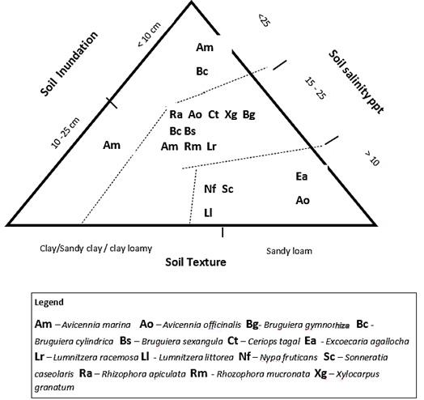

# Sri Lanka Figure17: T4 image hold resolved to explicit source questions

31 October 2026. Source PDF138, printed page112. Ruleset v1.9.2; T4 review contract.

## Recovered information

The native embedded image is preserved byte-for-byte below, with its PDF and image
hashes in `validation.json`. Full-page, native-image and enlarged-axis inspection makes
all three axes, fourteen species codes and eighteen code occurrences readable.
`figure_inventory.json` retains the legend, source labels, descriptive placements and
separately anchored surrounding prose. This replaces an unspecified readability hold
with explicit scientific/representation holds; it does not resolve calibration.

## What is supported

The accompanying text explicitly uses soil salinity, soil texture and inundation pattern
jointly to select planting species. Local natural zonation is also recommended. This is
positive **species-selection method-use** evidence. No numerical weights, response
scores or validation statistics appear. Repeated codes within the diagram are multiple
placements of the same species, not independent studies or additional support votes.

The inundation labels are **<10 cm** and **10–25 cm**. Their unit makes this a depth
representation; it cannot populate `tidal_inundation_duration` (percent time flooded).
It also cannot silently become generic terrain elevation or groundwater-table depth.

The texture labels are **Clay/Sandy clay/ clay loamy** and **Sandy loam**. Preserve these
literal source classes; no verified USDA crosswalk or compositional mixing rule supplied.
This is not a conventional ternary plot with three fractions summing to one.

## What remains held

1. **Salinity signs:** the image prints **<25**, **15–25**, **>10** from top to bottom,
   with axis label **Soil salinity ppt**. Those inequalities overlap. Neither rendering
   nor surrounding prose supplies permission to reverse them, replace 10 with 15, or
   impose mutually exclusive classes. A presumed typographic correction is not evidence.
2. **Joint geometry:** dashed boundaries and species placements do not define separately
   calibrated one-variable envelopes. No independent optimum/range or suitability direction
   is extracted for each species by projecting positions onto the sides.
3. **Depth semantics:** tidal datum, measurement timing/statistic and endpoint inclusion
   are unspecified. The image does not define frequency or duration.
4. **Attribution:** no specific primary citation accompanies the figure caption or its
   explanatory paragraph. The document bibliography alone does not identify the diagram's
   calibration source. No unverified primary lineage is invented.
5. **Admission:** image-derived labels are retained as source inventory, not text-verified
   EV quotes. Surrounding prose is independently text-verifiable but does not contain the
   image's numerical labels. No staging-gate bypass or fictitious native quotation.

## Concrete review questions

- Are the two printed salinity inequalities correct? Obtain an authoritative correction
  or the original calibrated diagram, including all class endpoints and units.
- What exactly does inundation depth measure, and how should a site be located within
  the joint three-property diagram? A worked example or original method is needed.
- Which study or expert process supports the species placements, and what is its geographic
  transfer scope? Confirm before interpreting diagram positions as species tolerances.

These are source clarification tasks, not requests to approve an inferred rule. No author
or team message was sent. Existing human approvals and family definitions remain unchanged.

## Verification and scope

Native image extracted directly from PDF image object826 (524×494 pixels); no image
editing or synthetic reconstruction. Fourteen unique legend codes reconcile with all
18 visual placements. Surrounding method quote matches PDF138. Inspection is by the
coordinating agent, not an independent human reviewer. Pixel identity verifies the
artifact, not ecological meaning.

No source/register, analytical table, generated JSON, progress stage or review decision
changed. No additional text-coverage progress claimed: prior text screening remains
complete at its documented level. Image calibration and mapping remain in progress.
No new extraction sweep or metric is implied; T3/T6 work is untouched.
