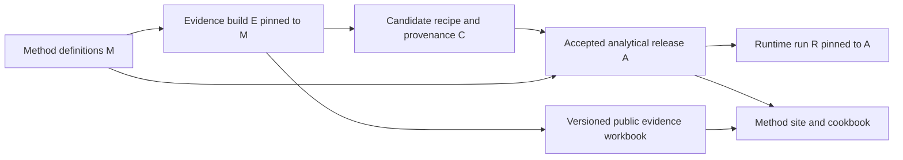

# Rural Scan: organization, repository and delivery migration plan

Date: 5 November 2026. Status: proposed execution baseline; phases require their stated acceptance gates.

Execution has started: see the [Phase 0 record](phase-0/README.md) for the refreshed baseline, verified private recovery snapshot, table/function ownership schedules and exact 15-file initial import proposal. CIAT remains authoritative; no evidence cutover has occurred.

M07/M08 work inside CIAT now includes the [T4 explicit-input adapter](m07-t4-build-paths.md) (PR #586), [generator paths and operation boundaries](m07-generator-paths.md) (PR #588), [staged artifact publication](m08-staged-publication.md) (PR #591) and [explicit review replay](m08-review-replay-paths.md) (PR #596), all merged. The [review-record recovery slice](m08-review-recovery.md) is merged in PR #599. The [direct review writers and dashboard refresh slice](m08-review-writers.md) is merged in PR #602. The [explicit T3/T6 synthesis slice](m07-t3t6-build-paths.md) is merged in PR #606. The [gated evidence-intake slice](m07-evidence-intake-paths.md) is implemented pending merge. Discovery registration, acquisition/source promotion, other writers, reader-consistent release publication and the broader layout/ownership split remain open.

This plan moves the project towards a readable, reusable World Bank methodology and a reproducible implementation, while evidence review continues. It is not an instruction to move the entire existing repository or to change analytical decisions during a repository move.

## 1. Outcome and decisions

A World Bank technical team must be able to understand the method, select a recipe, inspect its evidence, run a documented example, and extend the evidence without relying on Pete's memory or a particular AI chat.

Three substantive repositories are recommended:

| Repository | Purpose | Authoritative material |
|---|---|---|
| `RuralScan/method` | Understand and implement Rural Scan | Cookbook; concepts and modules; schema and interface definitions; approved policies, vocabularies and configuration; accepted analytical release manifests; visual identity; public documentation site |
| `RuralScan/evidence` | Maintain the evidence and compile candidate recipes | Source/evidence/search records; discovery, acquisition, extraction, review and synthesis tools; operating handbook; ruleset history; audit/provenance records; one workbook UI codebase |
| `RuralScan/runtime` | Execute the method | Diego's runtime, data adapters, spatial computation, conformance checks, run configuration, executable notebooks and Haiti example |

The public site is assembled from method content and a **pinned public build of the evidence workbook**. Its review-enabled build remains operational in the evidence workbench. Do not copy the dashboard JavaScript into two independently maintained applications.

The five work areas therefore have clear homes without five separate repositories:

1. Conceptual work and data model → method.
2. Visual identity → method; released assets consumed by other interfaces.
3. Reusable AI-supported discovery, screening and extraction → evidence.
4. Evidence and compilation → evidence; accepted analytical releases published through method.
5. Haiti demonstration → one executable example in runtime; explanation and versioned results linked from method.

An application repository is conditional. Inspect `dagudelo30/nbs-ruralscan` for useful application/notebook work; do not create a fourth active codebase merely because the older repository exists. An organization `.github` profile repository, if needed, contains product navigation only. Project governance stays in the existing workspace.

### Confirmed by Pete in this chat

- Use organization name **RuralScan**, if GitHub accepts it; GitHub Free.
- Initial owner: **peetmate**. Contact: **P.Steward@cgiar.org**.
- Copy **dagudelo30/nbs-ruralscan-runtime first**; assess the older application repository separately.
- Keep review work running during migration.
- Address dashboard feedback exported on 5 November as a separate active work item before the migration makes its targets stale.

Organization setup completed on 5 November: [RuralScan](https://github.com/RuralScan) exists on GitHub Free, with peetmate verified as an active owner and the agreed contact. Pete confirmed acceptance of GitHub's terms at creation. [RuralScan/runtime](https://github.com/RuralScan/runtime) is a public fork of Diego's runtime; both default heads and all advertised branch/tag refs match `78fba87d88a6f1d1a308e06632fb7fec76032696`. No runtime files, existing package/data pins or upstream repositories were changed. See the [setup verification record](setup-verification.md). Owner recovery, additional maintainers, protections and the agreed future runtime work location remain governance follow-ups; no colleagues were invited automatically.

The immediate feedback work merged in [PR #578](https://github.com/CIAT/nbs_ruralscan/pull/578): ten note dispositions, the interface fixes and a read-only audit of all 17 cross-family agroforestry source records / 96 claims. That audit found a confirmed duplicate identity and specific scope questions; it does not authorize automatic reclassification. Follow-on priority controls merged in [PR #582](https://github.com/CIAT/nbs_ruralscan/pull/582) with passing CI; the repaired build is loaded in the local dashboard preview.

### Constraints retained

- Scoping, not site-level feasibility or detailed engineering/CBA.
- Two pilot applications and reproducible notebooks remain contracted deliverables; Haiti alone does not satisfy the two-pilot obligation.
- Framework → recipe → runtime separation; analytical rules come from approved configuration, not hardcoded runtime thresholds.
- CSV remains the authored data source; JSON is generated. T3/T6 and other compiled recipe outputs are generated, not edited independently.
- Suitability families, spatial product types, two risk lenses, soft-operational routing, species/crop treatment, soft deletion, provenance and human review retain existing ratified rules.
- No evidence IDs, historical decisions or ruleset stamps are rewritten for cosmetic consistency.
- Preserve CIAT notices and contributor attribution, including Benson's inherited framework work and Diego's implementation.

## 2. What the audit found

Planning checkout baseline: **CIAT/nbs_ruralscan `598202af26669c300003c78a590624be936ea39a`**. Live review can advance beyond this; this is an inventory baseline, not a freeze. Auditors also read `72386b2a548481580ef72c661134d820907a923e` in the original checkout; the relevant method and entrypoint documents were checked against the planning baseline. Dirty acquisition files in the original checkout were not changed.

Tracked baseline contains **2,960 files**: `docs/` 850 files/~141 MiB, `methodology/` 811/~10 MiB, `handoff/` 446/~40 MiB, `pipeline/` 226/~14 MiB and `schema/` 183/~47 MiB. These sizes describe the checked-out files, not Git history. Much of the apparent clutter is audit lineage or repeated generated handoffs; classify it before excluding it from the new active tree.

| Finding | Evidence | Consequence |
|---|---|---|
| Reader entrypoints are stale | Root README says mock-only/June kickoff; `docs/README.md` says inline HTML/no build; notebook guide describes Sierra Leone | Rewrite entrypoints and mark historical claims, rather than copying prose unchanged |
| Some recipe guides contradict current rules | Water-harvesting README says JSON-first; older recipe prose includes superseded scope/operational assumptions | Do not promote those guides to the new cookbook without method-owner review |
| Evidence machinery is substantial | Discovery/extraction skills, central registrars, validators, review replay, synthesis and developer contracts exist | Document and package the working system; do not replace it with a new collection of prompts |
| Build depends on the whole repository | `schema_tools/generate.py` reads registers, operational ledgers, review logs, reference material, presentation data and runtime helpers | Introduce explicit build inputs and separate commands before moving directories |
| Review state is partly outside Git | Local decisions/clarifications and browser feedback | A Git copy alone cannot preserve ongoing work |
| Public CI may skip full quote verification | `schema_tools/validate_sources.py` when corpus is absent | Require a separate full-corpus attestation for evidence releases |
| Diego's active runtime already has a boundary | Runtime `upstream/PIN.json` pins CIAT developer v0.1.5 / contract 0.2.0 with hashes | Keep the existing pin during the organization copy; upgrade separately |
| Active runtime is a bounded prototype | `78fba87d88a6f1d1a308e06632fb7fec76032696`, 4 November; CI passed | Preserve its working baseline and authorship |
| Older Diego repository is a broad September snapshot | `b1cc1dc5dc4556a4c3908a9684d151988e1bc05c`; historical Haiti notebooks; latest inspected CI failed | Select useful pieces explicitly; do not import old schema as current authority |
| Haiti is not a completed policy run | Current runtime notebook has no committed executed outputs; exploratory gate/grid assumptions remain | Separate reproducible exploratory example from policy-conformant first pass |
| Runtime reuse license is unresolved | Active runtime has no LICENSE in inspected tree | Preserve history; agree redistribution/reuse terms with Diego before a reusable WB release; do not invent a license |

The audit references and migration groups are recorded in [migration-map.csv](migration-map.csv). That map is a planning inventory, **not a file allowlist**. The file-level migration manifest must be approved before copying CIAT material into the new repositories.

## 3. Ownership and release flow

### 3.1 One authority per kind of information

| Information | Authoritative home | Change route |
|---|---|---|
| Module meanings, scope, schema structure, variable/family semantics | method | Method change proposal and named scientific approval |
| Controlled vocabularies and approved analytical policies | method | Versioned definition release; compatibility report |
| T1/T2/T5/T7 configuration, BIND and family/variable configuration | method | Review dataset meaning/units/context and publish configuration version |
| SRC/EV/SRCH records, acquisition status, review events, omissions and holds | evidence after cutover; CIAT until then | Central validated registration/review operations |
| Extraction instructions and defect catalogues | evidence | Versioned SOP/ruleset change with regression example |
| Synthesis code and candidate T3/T4/T6/T6E tables | evidence | Deterministic compilation against pinned definitions and evidence snapshot |
| Accepted compiled recipe bundle | method release | Accept candidate bundle by hash and decision record; no hand-edited second copy |
| Spatial data adapters, computational implementation and exports | runtime | Code PR with conformance and data-fitness checks |
| Publication counts and evidence workbook rendering | one evidence UI package/build | Shared definitions/tests; public and reviewer capability modes |
| Visual tokens, assets, figure conventions and reusable brand guidance | method | Versioned design release; consumers pin version |

Every lookup and register must be classified individually. A filename under `schema/registers/` does not imply it belongs in evidence: FAM/VONT/BIND configuration differs from SRC/EV/SRCH observations. The complete table-by-table ownership schedule is a Phase 0 exit requirement.

### 3.2 Avoid a cross-repository build cycle



Definitions and accepted analytical releases are different products even if published from the same method repository. The compiler does not consume an accepted recipe that it is currently trying to generate. No release step depends on another repository's moving `main`.

Preserve the current **full-corpus parity check before country or evidence filtering** while separating these products. Authored gates, run policies and other configuration are explicit definition inputs; generated response rows are compiler outputs. A portability-only rebuild must reproduce the audited tables from the same pinned inputs. A build with changed evidence or definitions first compares its complete candidate with a pinned, previously accepted baseline and records the semantic changes and unresolved reconciliation holds. Candidate generation does not approve those changes. Publication requires their explicit disposition and full-corpus reconciliation; narrowing a filter cannot hide a stale recipe or bypass a hold. Test this failure mode, not only matching output hashes.

A small contracts/validation package can live **inside method** and be consumed by evidence and runtime. Give each shared helper one owner; do not make runtime a dependency of the evidence compiler. Reconcile numeric/categorical/reference functions with shared conformance fixtures. Existing CIAT implementations remain reference material until parity and ownership are established; do not copy empty runtime stubs over Diego's code.

### 3.3 Minimum cross-repository interface

A published analytical manifest identifies:

- definition/schema version and source commit;
- developer contract version and supported runtime versions;
- recipe release and readiness by family/function;
- evidence release ID, source snapshot SHA and validation attestation;
- compiler version, policy/ruleset hashes and publication decision;
- hashes for every machine file and referenced provenance bundle;
- immutable URLs plus an offline retrieval manifest;
- migration origin where applicable; licensing/access instructions.

A runtime manifest adds runtime commit and environment lock, selected configuration, AOI identity/hash, dataset identifiers/versions/access dates, transformations/resampling, grid/CRS/nodata, selected method/recipe/evidence pins, output checksums/statistics and unresolved assumptions.

Test valid input, unsupported version, missing file, altered hash, stale function fingerprint and missing required gate. Unsupported inputs must fail clearly. Model-generated proposals are not promised to reproduce byte-for-byte; accepted machine outputs must regenerate deterministically from recorded canonical inputs, excluding documented timestamps.

### 3.4 Single workbook codebase

Initially retain workbook source with evidence tooling, where the current generator and review service already live. Build two capabilities from the same version:

- **Public workbook:** browse bibliography, claims, progress and compilation lineage; reads an immutable publication bundle; no functional review submission endpoint.
- **Reviewer workbench:** same IDs, counts and evidence components plus authenticated/local review operations against the authoritative review system.

Method site embeds or deploys the pinned public build under its navigation; it does not fork the JS. Preserve stable source/claim URLs and feedback keys. Export/import browser feedback when changing hostnames. A future component package is justified only by demonstrated reuse, not by organizational neatness.

## 4. Target structure and reader experience

**Content boundary (5 November 2026):** new repositories contain reusable technical material only. No project-management records, named project parties or governance documents. Administration and this migration plan stay in the existing project workspace. The [destination content boundary](product-content-boundary.md) supersedes earlier import suggestions where mixed technical/admin material occurs.

These trees are design targets, not bulk move commands. Runtime keeps its current clear structure during the initial copy.

```text
method/
  README.md                       # Understand / implement / extend
  handbook/
    start-here.md
    concepts/                     # Purpose, scope, terminology, seven modules
    modules/                      # Inputs, steps, outputs, interpretation
    cookbook/                     # How to assemble/run a recipe
    limitations/                  # Scoping boundary, transfer, unknowns
  data-model/
    spec.md
    structure/                    # Manifest and machine schemas
    vocabularies/
    configuration/                # Authored configuration, approved policies
    contracts/                    # Versioned publisher/consumer interfaces
  recipes/<nbs_id>/                # Reader guide + accepted-release reference
  packages/contracts/             # Small reusable validation/reference API
  design/
    principles.md
    tokens/
    assets/
    figures/                      # Editable source + accessible/exported figure
    attribution.csv
  site/                           # Handbook site; pinned workbook build reference
  examples/haiti/                 # Narrative/report, runtime notebook links
  releases/                       # Manifest/index source; bulky artifacts outside Git
  tests/
  tools/
  LICENSE, CITATION.cff            # Required notices and scientific citation metadata

evidence/
  README.md
  handbook/                       # Operator and reviewer instructions
  contracts.lock                  # Pinned method definitions, not editable copies
  registers/                      # Authoritative evidence/source/search CSVs
  rulesets/current/
  rulesets/versions/               # Immutable historical instructions
  workflows/                      # Machine-readable workflow definitions/adapters
  src/                            # Acquisition, registration, checks, synthesis, review
  apps/workbook/                  # Single public/reviewer UI source
  tests/
  fixtures/                       # Small lawful reproducibility/training examples
  runs/<run_id>/                   # Compact manifests/reports; large artifacts referenced
  audit/                          # Current holds + indexed historical lineage
  publication/                    # Export specifications and release manifests
  tools/
  .env.example, .gitignore, LICENSE, CITATION.cff
  # Local state/corpus/cache are configured external paths, ignored by Git.

runtime/                          # Start as unchanged Diego fork
  src/nbs_runtime/
  config/
  notebooks/                      # One maintained executable Haiti notebook path
  tests/
  docs/
  upstream/PIN.json               # Existing handoff contract preserved initially
  examples/haiti/                 # Config, small fixture, expected results/report manifest
  pyproject.toml
  # Add tested environment lock and Colab bootstrap separately.
```

Use lowercase folder names; keep stable scientific IDs such as `water_harvesting_conservation`. Each top-level directory gets a short technical README explaining purpose, inputs, outputs and dependencies, without project assignments or administration. No unexplained `final`, `final2`, duplicate handoff directories or personal absolute paths in current documentation.

Public navigation should answer five tasks: **Understand Rural Scan → Choose a recipe → Implement it → Inspect evidence → Extend evidence**. Add a prominent **Run Haiti example** entry. Progress is supporting transparency, not the only entrance to the methodology. Show release/readiness labels consistently and provide printable cookbook material.

### Cookbook and recipe template

Each recipe includes:

1. Stable identity, version, authors, status and compatible method/runtime releases.
2. Decision supported, scope and intended outputs.
3. Families, grouping rationale, variants and spatial product type.
4. Applicability and transfer assumptions.
5. Required variables/datasets: units, depth/time, native support, binding, fallback and missing-input behavior.
6. Suitability responses, observed host gates, hard exclusions and unknown states.
7. Distinct livelihood need, investment risk, benefit response and T6E economics.
8. Execution sequence, documented choices, aggregation/weighting and conformance examples.
9. Evidence chain, review state, compilation method and known gaps.
10. Worked example and expected outputs.
11. Quality/sensitivity/resolution checks.
12. Interpretation, limits and feasibility hand-off.
13. Maintenance/change procedure.

Author explanations once. Generate repeated thresholds, rules, dataset lists and evidence summaries from the accepted configuration. A narrative example must never silently become a second analytical rule.

## 5. Professional evidence operating system

The goal is a documented, testable operating process usable by people and different AI tools. Vendor-specific skills remain thin adapters to normative, versioned SOPs; archived skill snapshots are retained to explain historic records.

### Handbook contents

| SOP | Inputs and outputs | Primary responsibility |
|---|---|---|
| 01 Scope and coverage | Authorized family/table/role, coverage goals, stopping rules → run scope | Human method owner |
| 02 Discovery and screening | Seed set, queries, criteria and search limits → candidates, protocols, screening decisions, report | Agent proposes; orchestrator records; human handles ambiguity |
| 03 Identity and acquisition | Candidate title/DOI/access checks → verified identity, source artifact hash and library path | Acquisition operator and deterministic checks |
| 04 Index and locators | PDF/web/code/Word artifact → versioned index, page/section/file-line locators | Supported adapter; unsupported formats remain held |
| 05 Extraction | Authorized source/scope/ruleset → atomic staged claims, omissions and holds | Extraction agent; no authoritative writes |
| 06 Validation and independent challenge | Staged claims → checks, omissions review, accepted/held registration proposal | Validators and independent reviewer |
| 07 Human review and clarifications | Evidence cards → Keep/Drop/Query/reclassify, conflicts and audit events | Reviewers; central consensus/replay mechanism |
| 08 Synthesis and publication | Pinned inputs and policy → candidate recipe, lineage, readiness, validation report | Compiler and release maintainer; acceptance remains explicit |
| 09 Retrospective and ruleset change | Defects/metrics/decisions → regression case and versioned instruction change | Method/evidence maintainers |
| 10 Recovery and maintenance | Interrupted runs, failed submissions, source updates → safe restart/replay | Operator following tested runbook |

Every SOP states purpose, prerequisites, owner, permitted writes, exact maintained command, outputs, pass/hold/fail criteria, recovery and next step. Commands in the future handbook must be demonstrated on the fixture before they are advertised as working; proposed CLI names are not an implementation claim.

Existing discovery outputs (`candidates.json`, `protocols.json`, `screening.json`, `report.md`) should become an explicit documented interface. Preserve central registration, title/DOI verification, source acquisition rules, atomic quote/locator provenance, scope checks, dropped-record retention and search-ledger reconciliation.

### Run manifest and auditability

Record run ID; authorized scope; source/definition/compiler/ruleset versions; actor and review identities; model/provider identifier when AI is used; instruction/template hashes; query/retrieval parameters and legally retainable response snapshots; source hashes; tool/environment versions; input/output hashes; validation results; omissions and unresolved holds; review decision references; produced release IDs.

Separate **automated checks**, **independent AI critique**, **human decisions**, **compiled output**, and **runtime readiness**. One does not imply the next. Avoid reporting skipped checks as passed. Full corpus verification remains a distinct authorized operation with a dated attestation; public CI uses small synthetic/open fixtures and declares its coverage.

### First complete training example

Choose one lawful, small source and one family/table lane. Include candidate/protocol/screening files, identity/acquisition evidence, source text/locator, one valid claim, one deliberately invalid claim, a query/reply, keep/drop/reclassify examples, compiled output and runtime fixture. A new operator must add a source, correct a claim, resolve a query and rebuild a candidate using only the handbook. No real reviewer records are changed by this exercise.

## 6. Selective migration and preservation

Every candidate file receives one disposition: **carry**, **rewrite**, **generate**, **archive-reference**, **controlled-state**, **exclude**, or **unresolved**. A directory-level map is not permission to copy all its contents.

The file-level manifest records old repository/SHA/path/hash, destination repository/path or immutable artifact URI, disposition/reason, canonical owner, scientific/publication status, rights/access classification, references/dependencies, reviewer and acceptance status. Scan Git history as well as current files for any history-preserving copy. Do not rewrite or delete legacy history as part of tidying.

- Carry current canonical records, supported implementations and meaningful tests.
- Rewrite reader entrypoints and conflicted current method guidance.
- Generate JSON, site payloads, repeated reference tables and release packages from pinned sources.
- Archive-reference dated audits, superseded wireframes, old handoffs and experiments; retain stable commit links and hashes. Keep active unresolved holds in current operations.
- Transfer local reviewer state through a controlled backup/import, never public Git.
- Keep full corpus, credentials, restricted datasets and machine caches in authorized storage. Review existing crop screenshots and quote images before redistribution; the project's MIT license does not automatically license third-party material.
- Exclude unrelated scratch outputs and obsolete duplicates from the new active trees, with a recorded reason and recoverable origin.

New method/evidence repositories should start from curated, attributable imports with origin manifests, rather than automatically inheriting every historical blob. Diego's runtime is different: preserve its commit history and upstream identity in an unchanged fork. Existing CIAT repository remains the live authority during transition and an accessible provenance archive after all consumers have moved.

## 7. Execution sequence and gates

The machine-readable [execution-board.csv](execution-board.csv) gives task IDs, dependencies, proposed owners and evidence required to close each task. Owners are proposals, not new assignments communicated to colleagues. Work in small PRs; each row closes only when its acceptance evidence is linked.

Phase numbers group work; the board's `depends_on` values define the execution order. After shared portability and publication prerequisites, **Haiti work (M19–M21) and evidence cutover (M22–M25) are parallel tracks**. Haiti transfer, soil or legal-mask decisions in M20 do not block a proven evidence cutover. Publish the accurately labelled H1 report through M21 while H2 remains open; final handover M26 separately requires M20, M21 and M25. This keeps scientific holds visible without turning them into unrelated infrastructure dependencies.

### Phase 0 — Baseline and safeguard ongoing work (M00–M03)

1. Snapshot repository heads, branches/tags, CI status, licenses, deployments, data hosts and current analytical pins.
2. Inventory active reviewer clones, pending submissions, local stores and current browser feedback. Also inventory every canonical writer: discovery/acquisition registrars, extraction/intake operators, synthesis/publishing jobs, scheduled agents and direct or PR-based table updates. Back up with checksums to controlled storage; keep IDs/private notes out of public planning artifacts.
3. Complete table/function/file authority map and migration allowlist, including unresolved holds and issue/PR links.
4. Review and address 5 November dashboard feedback in a separate PR; add resulting stable behaviors to migration acceptance checks.

**Exit:** no unclassified proposed import; baseline and restore procedure exist; current review still writes only CIAT; feedback is linked to its fix or explicit deferral.

### Phase 1 — Organization and unchanged runtime copy (M04–M06)

1. Create `RuralScan` with confirmed account/contact and Free plan. Establish public description and repository visibility. Record owner recovery and propose a second trusted owner; grant access only to explicitly agreed people/roles. Do not add organization-wide write/admin access as a convenience.
2. Fork `dagudelo30/nbs-ruralscan-runtime` into `RuralScan/runtime`, preserving upstream linkage and commit attribution. Record all original refs; verify selected default head/tree. If required tags/branches are not included by the fork operation, copy the missing refs explicitly to the empty destination and verify them. Do not repeatedly mirror-push over subsequent organization work.
3. Keep package distribution `nbs-ruralscan-runtime`, Python import `nbs_runtime`, existing paths, CIAT publisher pin and Hugging Face `dagudelo30/nbs-ruralscan-data` unchanged. Forking Git does not move external data hosting, secrets, deployments, issues or review processes.
4. Run existing runtime checks before any cleanup. Inventory issue/PR/release metadata separately. Record canonical runtime work location/cutover with Diego, the unresolved license status and its resolution owner, and branch/review protections. Until that coordination, the fork is a staging copy; upstream changes enter as reviewed PRs. Preserve all attribution and notices; do not add a guessed license.
5. Create method/evidence repository skeletons with concise technical READMEs and verified notices. Keep project administration and governance in the existing workspace; apply the destination content boundary before every import. No bulk data import yet.

**Exit:** unchanged staging fork matches source; original pin still verifies; original remains intact; deployment/access metadata and any unresolved license gap are recorded. This gate does not certify a reusable distribution. An explicit reuse/redistribution license decision is required before publishing a reusable runtime release or WB handover, and is checked again in M26. A fork preserves code continuity; transfer is a later owner action only if agreed, not this plan's default.

### Phase 2 — Make the existing pipeline portable before splitting it (M07–M10)

The [explicit review replay slice](m08-review-replay-paths.md) adds isolated record replay and preserves the existing shipping route. It records remaining writer paths and failure-recovery work; it does not move review authority.

1. Refactor inside current CIAT repository: explicit paths/build context instead of hidden `parents[...]` roots; preserve current commands as compatibility wrappers.
2. Separate validation, synthesis, dashboard export/build, release packaging and review submission. Inventory every input before assigning its new home. Separate authored gates/policies from generated recipe rows, retaining the full-corpus before-filter parity protection described in section 3.2.
3. Extract the small shared contract/validation interface; decide ownership of codelist/scoring helpers and provide conformance fixtures. Eliminate compiler dependence on a separately deployed runtime.
4. Define release manifests and supported-version behavior. Exercise changed hash, unsupported contract, missing file and unready family failures. Test that a country/evidence filter cannot conceal an unreconciled full-corpus recipe change; require the pinned accepted baseline and semantic reconciliation report for changed-input candidates.
5. Build the end-to-end training fixture with frozen expected accepted outputs. Verify same results through the old wrapper and new explicit interfaces.

**Exit:** components run from declared inputs outside the old directory layout; golden outputs/IDs unchanged; full-corpus parity and filtered stale-recipe rejection remain effective; no dual authority; runtime still reads its original pin. Do not change ecological thresholds or gates in a path-refactor PR.

### Phase 3 — Curate method, cookbook and evidence handbook (M11–M14)

1. Rewrite current entrypoints and reconcile identified contradictory instructions against ratified decisions. Separate historical text from current normative guidance.
2. Publish method definitions/configuration and reference APIs as the first versioned contract release.
3. Complete one agroforestry family vertical slice: evidence → reviewed claim → compiled row → readable recipe → conformance fixture → runtime input. Resolve technical holds explicitly rather than presenting a clean layout as readiness.
4. Write evidence handbook and model-neutral workflow adapters from existing working commands. Preserve old rulesets and scientific traceability.
5. Publish shared identity tokens, diagrams, table/figure conventions, accessibility rules and attribution index. Keep T0–T7 colors and existing agreed semantic distinctions.

**Exit:** independent technical reader completes the fixture, explains the lineage and identifies provisional/unready parts without live coaching. Readable methodology can launch before live review is moved.

### Phase 4 — Release-backed public portal and runtime integration (M15–M18)

1. Deploy method site with current cookbook/data model and pinned public workbook build. Show separate method, evidence, recipe, UI and runtime versions where relevant.
2. Public and reviewer builds must give identical counts/IDs for the same evidence bundle. Keep Table default and all accepted dashboard feedback; preserve print/deep links and bibliography/evidence navigation.
3. Add configurable runtime publisher location while preserving old URLs and immutable pins. Test old and new package origins.
4. Remove project administration and named parties from runtime documentation. Neutralize public labels and person-named API/output identifiers through a coordinated compatibility change with consumers/tests; retain source pins and original provenance. Then upgrade runtime from developer v0.1.5 to v0.1.7 in its own PR with semantic diff/readiness report and conformance checks. Same contract number alone is insufficient proof of analytical equivalence.
5. Add pinned runtime environment and working Colab bootstrap; retain documented external authentication/access requirements.

**Exit:** independent clean checkout loads exact compatible releases; public site has no review write route; changed pins produce explicit change reports; old consumers continue to work.

### Phase 5 — Reproduce and complete the bounded Haiti demonstration (M19–M21)

Two milestones prevent overstating delivery:

- **H1: reproducible exploratory demonstration.** A clean user runs a small offline fixture and, with authorized credentials, a small live Haiti run. Published output accurately says partial slope/SOC/pH example, records skipped/unknown gates and provides execution/environment/data manifests.
- **H2: policy-conformant bounded first pass.** Approve AOI/extent, transfer applicability, soil policy and resolution/aggregation; implement real host and legal-mask inputs; verify treatment of eligible fractions, excluded/unknown cells and spatial product types. Merely filling a legal-policy string is not implementation of a legal raster mask.

Current 5 km exploratory defaults are not automatically acceptable for all variables. Explicitly test deriving scale-sensitive variables at appropriate support, then the agreed scoring/aggregation order. Do not silently average an input and assume it equals averaging the scored fine-scale response. Do not report a partly eligible coarse cell as fully suitable area.

Export maps/tables in agreed technical formats with CRS, units, nodata and interpretation; retain one executable notebook authority in runtime. Method site links the tagged notebook and rendered pilot report. Track missing M0–M6 modules and the second LDC pilot as separate delivery work; H1/H2 do not imply whole-project completion.

**Exit:** independent rerun, expected fixture results, documented decisions, actual gate implementations and scientific QA. Domain/data owner signs off; screenshots alone are insufficient.

### Phase 6 — Move evidence operations with no lost decisions (M22–M25)

1. Seed new evidence home from a named snapshot, keeping it read-only. Rehearse repeatable **one-way** delta import from still-active CIAT review.
2. Compare canonical row identities/hashes, review/clarification events, quarantined records, holds, ledgers and compiled outputs at each watermark. Account for corrections and reopenings, not only appended rows.
3. Rehearse pending agreement/disagreement, queries/replies, reclassification, failed submit, reopen and replay-idempotency on copies. Include discovery/acquisition registration, staged extraction intake, synthesis, scheduled jobs and direct/PR-based updates in the writer inventory. Align path allowlists/CI/auto-merge rules with new layout; do not silently broaden governance. Test the post-cutover rejection of old-path mutations through the API, scripts and PR/direct-push routes, including administrative bypass handling.
4. Arrange a short **canonical-write pause** for final switch across every inventoried writer. Reviewers may continue collecting local decisions; acquisition/extraction can continue staging material outside canonical records for later validated intake. Drain or explicitly hold in-flight submissions, jobs and PRs; capture the final source SHA plus pending/staged-state inventories; import the final delta, reconcile and record the authority watermark. No old-authority table mutation may land after that watermark without restarting reconciliation.
5. Change exactly one authoritative write destination. Old APIs and writer commands must reject further canonical writes with a clear new destination. Protect retired canonical paths against subsequent PR/direct updates and disable or retarget old jobs; verify the controls rather than relying on a notice. Update reviewer/operator clones and endpoints, import checked local stores and staged work, and hydrate source artifacts. Public pages and browser notes are migrated separately.
6. Submit a small real reviewer batch through the new endpoint, confirm consensus/audit/JSON/publication and verify pending decisions remain available.
7. Rehearse rollback: pause all canonical writers again, then reconcile a reverse delta covering every changed register, queue, review event and compiled output before returning authority. Never restore an old entire EV snapshot over newer decisions.

**Exit:** every writer and pending/staged item accounted for; one canonical authority; old API/script/job/PR paths cannot mutate retired records; old pins/links work; original stores backed up; no change in approval state solely from migration. Do not archive CIAT while any reviewer or runtime still depends on its active write/publisher behavior. These gates depend on portability, publication and replay readiness, not on completion of Haiti H2.

### Phase 7 — Handover and legacy retirement (M26–M27)

1. External technical reader starts from org landing page and completes three tasks unaided: explain one recipe's provenance; run Haiti fixture; add/review example evidence and rebuild a candidate.
2. Finish cookbook/recipe coverage checklist, dataset/method contracts, support/maintenance instructions, contributor citations and licensing/access matrix. Resolve the runtime reuse/redistribution license with its rights holders before a reusable runtime release or WB handover; an unchanged staging fork is not evidence that this gate passed. Provide printable methodology, executable notebooks and pilot report manifests.
3. Keep legacy CIAT repository searchable with a dated redirect/authority notice and pinned old releases. Close or cross-link migrated issues instead of copying every closed issue. Archive only after dependency inventory and review continuity gates pass; do not delete history or restricted team library.

**Exit:** delivery checklist signed, unresolved research/implementation limitations visible, maintenance responsibilities accepted and older results reproducible.

## 8. Review continuity runbook requirements

These are release-blocking, not optional cleanup tasks:

- Inventory **all active clones**, not just the planning worktree. The original local checkout currently contains uncommitted acquisition changes; do not assume it equals the remote snapshot.
- Preserve local `pipeline/review/decisions.json`, `clarifications.json` and recovery backups through explicit checked exports. Preserve tracked review/clarification logs, stable `(evidence_id, reviewer)` decisions and disagreement handling.
- Export browser feedback/preferences/clear-all recovery state through the supported feedback workflow; new origin will not inherit localStorage. The 5 November report is a task input and not a substitute for every reviewer's current state.
- Keep all canonical registration, review, synthesis and publication writes targeting current authority until declared cutover. Maintain the writer/job/PR inventory and enforce the final canonical-write pause and retired-path controls. Never merge a stale whole register to replay decisions.
- Append-only history and soft-deleted rows remain inspectable. No migration event fabricates search, review or verification progress.
- Snapshot completeness includes CSVs, policies, rulesets, logs, queue, configuration, lockfiles, artifact index and manifests. Current `freeze.py` alone is not sufficient.
- Monitor first live submissions and compare evidence IDs, event lineage, expected outcomes and state hashes, not only aggregate counts. Record rollback threshold and named operator before switching.

## 9. Governance, versioning and completion evidence

Proposed responsibilities (confirm with people before assigning work): Pete owns method/scope and acceptance; Diego owns runtime implementation and runtime continuity; Namita leads evidence QA/reviewer onboarding and M6 coordination; Brayden owns relevant climate/data contracts; domain specialists review recipe meaning. A migration operator can execute mechanical moves but cannot approve scientific changes.

Version independently: method definitions, developer contract, evidence snapshot, extraction ruleset, compiled recipe bundle, runtime package, workbook UI and design assets. One release manifest records the tested combination. Corrections to evidence do not silently mutate an already published analytical release. Use changelogs and compatibility tables, not one dashboard build number as a proxy for the entire project.

Use task IDs in PR descriptions and link acceptance reports. Each PR changes one logical layer. No bulk rename + policy change + data rewrite in the same PR. Require appropriate method, evidence or runtime owner review. Track open risks and decisions in the execution board; do not describe proposed owners or future tooling as already established.

### Completion scorecard

- Clear organization entrypoint and three concise repository READMEs.
- No current documentation contradicts CSV-first or ratified scope/risk rules.
- Every migrated item has a verified origin and declared authority.
- One maintained workbook source; public/review builds agree on counts and lineage.
- Lawful small evidence workflow reproducible by a newcomer.
- Exact provenance from search/source/locator to review to compiled row to runtime configuration.
- Runtime refuses unsupported or tampered contracts.
- Haiti exploratory and policy-ready statuses clearly distinguished; second pilot obligation tracked.
- No pending reviewer work lost, no dual writers, rollback demonstrated.
- Cookbook, notebook and pilot report deliverables usable by the intended WB technical audience.

## 10. Adversarial review changes already incorporated

Three independent audits covered runtime/integration, evidence/review, and delivery/information architecture. A second runtime review challenged the proposed architecture. Resulting changes:

1. Separate method definition release from accepted analytical release to remove build cycles.
2. Keep one workbook codebase; method site consumes its public artifact instead of copying JS.
3. Fork runtime unchanged before environment, contract or analytical improvements.
4. Retain existing CIAT and Hugging Face pins until explicit consumer-compatible changes.
5. Separate exploratory Haiti reproduction from actual policy-conformant execution.
6. Make full-corpus verification explicit; public CI success cannot substitute for it.
7. Move live review last, with one writer, delta/replay checks and reverse-delta rollback.
8. Preserve audit history and attribution while removing it from primary reader navigation.
9. Make the 5 November feedback an immediate parallel task with acceptance carried into the new workbook.
10. Preserve full-corpus before-filter parity and require semantic reconciliation against a pinned accepted baseline.
11. Cover every canonical writer at cutover, distinguish staging-fork licensing from reusable-release licensing, and run Haiti and evidence migration as independent tracks after their shared prerequisites.

## 11. References

Local sources: [`AGENTS.md`](../../../AGENTS.md), [`README.md`](../../../README.md), [`ONBOARDING.md`](../../../ONBOARDING.md), [`PLAYBOOK.md`](../../../PLAYBOOK.md), [`schema/spec.md`](../../../schema/spec.md), [`schema/structure/columns.json`](../../../schema/structure/columns.json), [`T4 generation method`](../../T4_generation_method.md), [`T3/T6 generation method`](../../T3_T6_generation_method.md), [`search protocol`](../../search_protocol.md), [`extraction retrospective`](../../extraction_retrospective.md), [`developer handoff`](../../../handoff/agroforestry-t4/START_HERE.md), [`generator`](../../../src/nbs_ruralscan/schema_tools/generate.py), [`review submission`](../../../src/nbs_ruralscan/schema_tools/submit_review.py), [`schema freeze`](../../../src/nbs_ruralscan/schema_tools/freeze.py), [`CI workflow`](../../../.github/workflows/ci.yml), [`review auto-merge`](../../../.github/workflows/auto-merge-review.yml).

External baselines: [Diego runtime at inspected commit](https://github.com/dagudelo30/nbs-ruralscan-runtime/tree/78fba87d88a6f1d1a308e06632fb7fec76032696), [runtime pin](https://github.com/dagudelo30/nbs-ruralscan-runtime/blob/78fba87d88a6f1d1a308e06632fb7fec76032696/upstream/PIN.json), [older repository snapshot](https://github.com/dagudelo30/nbs-ruralscan/tree/b1cc1dc5dc4556a4c3908a9684d151988e1bc05c).

GitHub operational references: [create an organization](https://docs.github.com/en/organizations/collaborating-with-groups-in-organizations/creating-a-new-organization-from-scratch), [duplicate repositories and LFS](https://docs.github.com/en/repositories/creating-and-managing-repositories/duplicating-a-repository), [transfer behavior](https://docs.github.com/en/repositories/creating-and-managing-repositories/transferring-a-repository). Copying Git and transferring a GitHub repository have different effects on issues, settings and external services; follow the chosen operation's current documentation at execution time.
